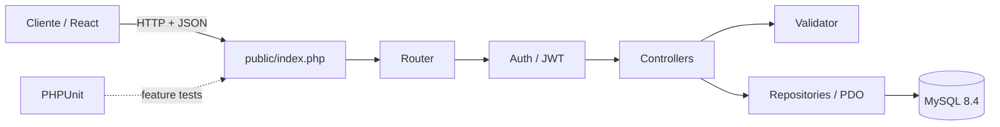

<h1 align="center">TaskFlow API</h1>

<p align="center">
  API REST para gerenciamento de projetos e tarefas, com autenticação JWT, filtros, paginação e dashboard.
</p>

<p align="center">
  <a href="https://github.com/code-sansjr/taskflow-api/actions/workflows/tests.yml">
    
  </a>
  
  
  <a href="LICENSE">
    
  </a>
</p>

## 📌 Sobre o projeto

O **TaskFlow** organiza projetos e tarefas de forma simples: cada usuário autenticado enxerga apenas os próprios dados, pode filtrar tarefas por status, prioridade, atraso ou busca, e acompanhar o progresso em um endpoint de dashboard.

A API foi construída **sem framework** para demonstrar fundamentos de engenharia: roteamento, PDO, SQL, validação, JWT, separação de camadas e testes de integração contra um banco real.

**Ecossistema:** esta API alimenta o [TaskFlow Dashboard](https://github.com/code-sansjr/taskflow-dashboard), interface em React + Tailwind CSS que consome todos os endpoints.

**Funcionalidades:**

- Cadastro e login com senha protegida por `password_hash` e autenticação JWT
- CRUD de projetos e tarefas com isolamento por usuário
- Status (`todo`, `doing`, `done`), prioridade (`low`, `medium`, `high`) e prazo
- `completed_at` atualizado automaticamente ao concluir ou reabrir uma tarefa
- Filtros por status, prioridade, tarefas atrasadas e busca por título
- Paginação padronizada em todas as listagens
- Dashboard com totais, atrasadas, tarefas do dia e taxa de conclusão
- Validação de entrada e respostas de erro consistentes
- CORS configurável para integração com o [TaskFlow Dashboard](https://github.com/code-sansjr/taskflow-dashboard)

## 🛠️ Stack

| Camada | Tecnologia |
| --- | --- |
| Runtime | PHP 8.4 |
| Banco de dados | MySQL 8.4 |
| Acesso a dados | PDO com prepared statements |
| Autenticação | JWT HS256 (`firebase/php-jwt` 7) |
| Testes | PHPUnit 11 |
| CI | GitHub Actions |
| Dependências | Composer |

## 🧱 Arquitetura



- **Core** — request/response, router, validação, paginação, conexão e schema.
- **Auth** — emissão e leitura de tokens JWT.
- **Controllers** — orquestram HTTP, validação e respostas; não escrevem SQL.
- **Repositories** — concentram o SQL e as regras de persistência; não conhecem HTTP.
- **Tests** — testes unitários e de integração executados contra o MySQL de teste.

## 🔌 Endpoints

| Método | Rota | Auth | Descrição |
| --- | --- | :---: | --- |
| `GET` | `/api/health` | — | Health check da API |
| `POST` | `/api/auth/register` | — | Cadastro e emissão de token |
| `POST` | `/api/auth/login` | — | Login e emissão de token |
| `GET` | `/api/me` | Bearer | Dados do usuário autenticado |
| `GET` | `/api/projects` | Bearer | Lista projetos com progresso |
| `POST` | `/api/projects` | Bearer | Cria um projeto |
| `GET` | `/api/projects/{id}` | Bearer | Detalha um projeto |
| `PUT/PATCH` | `/api/projects/{id}` | Bearer | Atualiza um projeto |
| `DELETE` | `/api/projects/{id}` | Bearer | Remove um projeto e suas tarefas |
| `GET` | `/api/projects/{project_id}/tasks` | Bearer | Lista tarefas do projeto |
| `POST` | `/api/projects/{project_id}/tasks` | Bearer | Cria uma tarefa |
| `GET` | `/api/tasks/{id}` | Bearer | Detalha uma tarefa |
| `PUT/PATCH` | `/api/tasks/{id}` | Bearer | Atualiza uma tarefa |
| `DELETE` | `/api/tasks/{id}` | Bearer | Remove uma tarefa |
| `GET` | `/api/dashboard` | Bearer | Resumo de projetos e tarefas |

### Filtros de tarefas

`GET /api/projects/{project_id}/tasks?status=todo&priority=high&overdue=1&search=php&page=1&per_page=20`

| Parâmetro | Valores | Descrição |
| --- | --- | --- |
| `status` | `todo`, `doing`, `done` | Filtra pelo status |
| `priority` | `low`, `medium`, `high` | Filtra pela prioridade |
| `overdue` | `1`, `true`, `yes` | Somente tarefas atrasadas e não concluídas |
| `search` | texto | Busca no título |
| `page` | inteiro | Página atual |
| `per_page` | 1–100 | Itens por página |

### Formato das respostas

```json
{
  "data": [
    { "id": 1, "title": "Estudar PDO" }
  ],
  "meta": {
    "page": 1,
    "per_page": 20,
    "total": 1,
    "last_page": 1
  }
}
```

```json
{
  "error": {
    "code": "validation_error",
    "message": "Validation failed.",
    "details": {
      "fields": {
        "title": ["The field is required."]
      }
    }
  }
}
```

Códigos usados: `200`, `201`, `204`, `401`, `404`, `405`, `422` e `500`.

## 🚀 Como rodar

### Pré-requisitos

- PHP 8.2+ (recomendado 8.4)
- Composer 2
- MySQL 8+
- Extensões PHP `pdo_mysql` e `mbstring`

### 1. Clone e instale

```bash
git clone https://github.com/code-sansjr/taskflow-api.git
cd taskflow-api
composer install
```

### 2. Crie o banco local

O arquivo `database/setup.local.sql` cria os bancos `taskflow` e `taskflow_test` e um usuário local `taskflow`.

```bash
mysql -u root -p < database/setup.local.sql
```

No PowerShell:

```powershell
Get-Content .\database\setup.local.sql | mysql -u root -p
```

> As credenciais desse arquivo são apenas para desenvolvimento local. Em produção, crie um usuário próprio e uma senha forte.

### 3. Configure o ambiente

```bash
cp .env.example .env
```

No PowerShell:

```powershell
Copy-Item .env.example .env
```

Gere um segredo JWT e cole em `JWT_SECRET`:

```bash
php -r "echo bin2hex(random_bytes(32));"
```

### 4. Aplique o schema e suba a API

```bash
php bin/migrate.php
composer serve
```

A API estará em `http://127.0.0.1:8000`. Confirme:

```bash
curl http://127.0.0.1:8000/api/health
```

### 5. Rode os testes

```bash
composer test
```

Os testes usam o banco `taskflow_test`, criam o schema automaticamente e fazem rollback de cada caso para manter isolamento.

## 📡 Exemplos de uso

### Cadastro

```bash
curl -X POST http://127.0.0.1:8000/api/auth/register \
  -H "Content-Type: application/json" \
  -d '{"name":"Sandro","email":"sandro@example.com","password":"password123"}'
```

A resposta inclui `data.token`. Use o token nas rotas protegidas:

```bash
export TOKEN="cole-o-token-aqui"
```

### Projeto

```bash
curl -X POST http://127.0.0.1:8000/api/projects \
  -H "Content-Type: application/json" \
  -H "Authorization: Bearer $TOKEN" \
  -d '{"name":"Estudos","description":"Projetos pessoais"}'
```

### Tarefa

```bash
curl -X POST http://127.0.0.1:8000/api/projects/1/tasks \
  -H "Content-Type: application/json" \
  -H "Authorization: Bearer $TOKEN" \
  -d '{"title":"Estudar PDO","priority":"high","due_date":"2026-12-01"}'
```

### Concluir e reabrir

```bash
curl -X PATCH http://127.0.0.1:8000/api/tasks/1 \
  -H "Content-Type: application/json" \
  -H "Authorization: Bearer $TOKEN" \
  -d '{"status":"done"}'
```

### Dashboard

```bash
curl http://127.0.0.1:8000/api/dashboard \
  -H "Authorization: Bearer $TOKEN"
```

## 🔐 Variáveis de ambiente

| Variável | Padrão | Descrição |
| --- | --- | --- |
| `APP_ENV` | `local` | Ambiente da aplicação |
| `APP_DEBUG` | `true` | Expõe detalhes de erro em desenvolvimento; use `false` em produção |
| `APP_TIMEZONE` | `America/Sao_Paulo` | Fuso horário do PHP |
| `DB_HOST` | `127.0.0.1` | Host do MySQL |
| `DB_PORT` | `3306` | Porta do MySQL |
| `DB_DATABASE` | `taskflow` | Banco da aplicação |
| `DB_USERNAME` | `taskflow` | Usuário do banco |
| `DB_PASSWORD` | `taskflow` | Senha do banco |
| `JWT_SECRET` | — | Segredo com no mínimo 32 caracteres |
| `JWT_TTL` | `3600` | Validade do token em segundos |
| `PASSWORD_HASH_COST` | `12` | Custo do bcrypt (4 em testes) |
| `CORS_ALLOWED_ORIGIN` | `*` | Origem permitida no CORS |

Nunca versione o `.env`. Use o `.env.example` como referência.

## 🧪 Testes

```text
PHPUnit 11.5.58
38 tests, 248 assertions
```

A suíte cobre:

- cadastro, login, token inválido e rotas protegidas
- criação, listagem, atualização, exclusão e paginação de projetos
- CRUD de tarefas, filtros, transições de status e `completed_at`
- isolamento entre usuários (um usuário não acessa dados de outro)
- dashboard com contagens, atrasos e taxa de conclusão
- validação e roteamento como testes unitários

O workflow em `.github/workflows/tests.yml` roda os testes em cada push e pull request, usando PHP 8.4 e MySQL 8.4.

## 💡 Decisões técnicas

- **PHP puro + PDO** em vez de framework: o objetivo é demonstrar fundamentos de HTTP, SQL, arquitetura e testes, sem esconder o comportamento atrás de abstrações.
- **JWT stateless** com segredo de no mínimo 32 caracteres e TTL configurável. Refresh tokens e revogação ficam no roadmap.
- **Escopo por usuário em todas as consultas**: projetos são filtrados por `user_id` e tarefas por join com o projeto, evitando IDOR.
- **Prepared statements em todas as queries**, com `PDO::ATTR_EMULATE_PREPARES = false`.
- **Senhas com `password_hash`** e custo ajustável por ambiente; testes usam custo baixo para serem rápidos.
- **Validação centralizada** e envelope de erro consistente (`code`, `message`, `details`).
- **Testes de integração sem mocks**: o `App` é exercitado via requisições em processo contra o MySQL real, com transação e rollback por teste.
- **Schema com FKs, `ON DELETE CASCADE` e índices** para status e prazos.

## 📁 Estrutura

```text
taskflow-api/
├── bin/
│   └── migrate.php
├── database/
│   ├── schema.sql
│   └── setup.local.sql
├── public/
│   ├── index.php
│   ├── router.php
│   └── .htaccess
├── src/
│   ├── Auth/
│   ├── Controllers/
│   ├── Core/
│   └── Repositories/
├── tests/
│   ├── Feature/
│   ├── Unit/
│   ├── TestCase.php
│   └── bootstrap.php
├── .env.example
├── composer.json
├── phpunit.xml
└── README.md
```

## 🗺️ Roadmap

- [x] Dashboard em React + Tailwind consumindo a API — [TaskFlow Dashboard](https://github.com/code-sansjr/taskflow-dashboard)
- [ ] Deploy público com link no README
- [ ] Documentação OpenAPI/Swagger
- [ ] Docker Compose para desenvolvimento
- [ ] Refresh tokens e logout
- [ ] Rate limiting
- [ ] PHPStan e cobertura de testes no CI

## 📄 Licença

Distribuído sob a licença MIT. Veja [LICENSE](LICENSE).

## 👤 Autor

**Sandro (Code.SansJr)**

- GitHub: [@code-sansjr](https://github.com/code-sansjr)
- E-mail: [jott4pb@gmail.com](mailto:jott4pb@gmail.com)
- Instagram: [@code.sansjr](https://www.instagram.com/code.sansjr/)

<details>
<summary>🇺🇸 English overview</summary>

<br />

**TaskFlow API** is a REST API for managing projects and tasks, built with plain PHP, PDO and MySQL. It includes JWT authentication, per-user data isolation, task filters, pagination, a dashboard summary, validation and 38 automated tests.

**Highlights:** clean layer separation, prepared statements, `password_hash`, configurable bcrypt cost, consistent JSON errors and integration tests against a real MySQL database.

**Front end:** [TaskFlow Dashboard](https://github.com/code-sansjr/taskflow-dashboard) consumes every endpoint with React 19, Tailwind CSS 4 and TanStack Query.

**Run it:** `composer install` → configure `.env` → `php bin/migrate.php` → `composer serve` → `composer test`.

</details>
